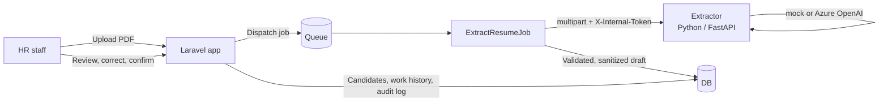
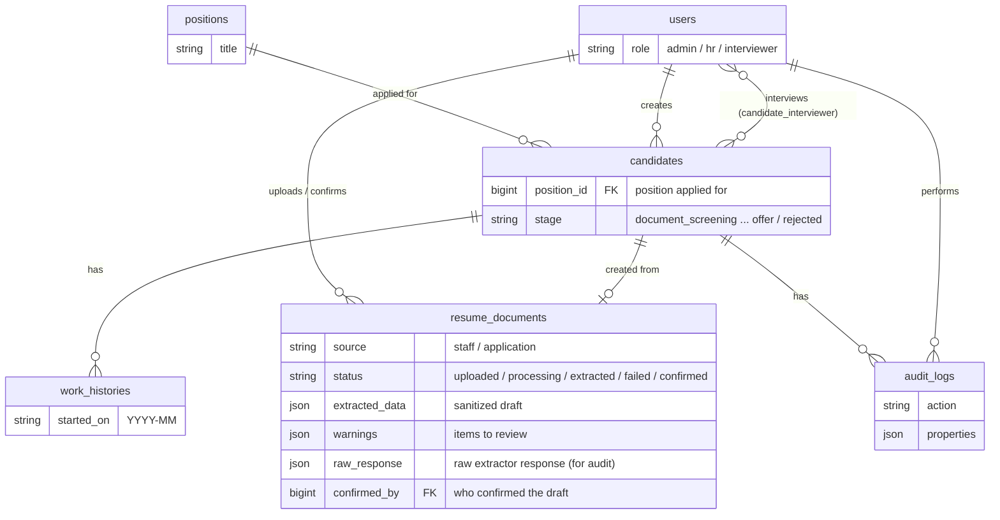

# Candidate Hub

A Laravel app that uses an LLM to read semi-structured Japanese resumes (履歴書 / 職務経歴書, PDF) and auto-fill a resume form.
The LLM output is treated as untrusted input: a person always checks the pre-filled form against the original PDF, corrects it, and only then confirms it.
Confirmed data then flows into a recruiting workflow (selection stages, interviewer assignment, audit log).

[日本語](README.md)


**Live demo:** <https://candidate-hub.demo.roymwxuk.uk/> ([demo accounts](#demo-accounts-password-is-demopassword56-for-all))

## Why this problem

Japanese resumes follow a loosely standard format, but the order of sections and the wording vary from person to person. HR staff re-typing them by hand is a real cost in recruiting. Letting an AI register candidates fully automatically is too risky, because errors slip in, so the design is "the AI writes a draft, a person reviews and confirms it."

**Stack:** Laravel 13 (PHP 8.3+), Blade + Tailwind CSS, queued jobs, SQLite (dev) · Python 3.12 / FastAPI extractor (rule-based mock or Azure OpenAI structured outputs) · PHPUnit, pytest · GitHub Actions · Docker Compose.

## Features

**Resume auto-fill (core feature)**

| Feature | Description |
| --- | --- |
| AI extraction | Upload a PDF → a queued job runs → the extractor service (rule-based / Azure OpenAI) returns structured JSON |
| Review screen | Original PDF on the left, pre-filled form on the right. Invalid fields are shown as warnings; a person fixes them before confirming |
| Accuracy tracking | On confirmation, the fields the reviewer changed from the AI draft (`corrected_fields`) are recorded |
| Public careers pages | Open roles, job descriptions and an application form at `/jobs`, no login needed. When an applicant uploads a resume the form is auto-filled, and **the applicant reviews and corrects it before submitting**. The application enters document screening already tagged with the role. Consent to the privacy policy is required, and uploads are rate limited per IP |

**Recruiting workflow after registration**

| Feature | Description |
| --- | --- |
| Selection stages | Stage transition rules are enforced (no skipping stages, no moving back mid-process, no changes after an offer). A rejected candidate can be sent back to document screening after a confirmation dialog |
| Roles | Admin / HR / Interviewer. Interviewers only see candidates assigned to them and cannot open the original resume |
| Audit log | Records stage changes, interviewer assignments, and fields corrected from the AI draft |
| User management | Internal tool, so no self sign-up. Admins create accounts |

## Architecture



- **Laravel**: the core of the domain. Owns candidates, selection stages, permissions, the audit log, and the human review flow.
- **Extractor (`./extractor`)**: a stateless microservice that only does PDF → structured JSON. It stores neither files nor results.
  - `EXTRACTOR_PROVIDER=mock`: rule-based extraction (no API key; for demos and tests, and as a baseline to compare LLMs against)
  - `EXTRACTOR_PROVIDER=azure_openai`: Azure OpenAI Structured Outputs (JSON schema enforced) returns schema-conformant JSON
- Laravel depends only on the `ResumeExtractor` interface, so swapping the extraction engine does not touch domain code.

## Data model



- `resume_documents.source`: `staff` means HR uploaded it in 履歴書取込 (HR reviews the draft); `application` means an applicant uploaded it on the public careers page (the applicant reviews it).
- On delete: deleting a candidate also deletes their work history, interviewer assignments and audit logs, and only unlinks their resume. Deleting a position or user sets the reference to `null`, so candidates and audit logs are kept.
- The candidate's profile columns (address, education, preferences and so on, about 25) are left out of the diagram.

## Design decisions

1. **LLM output is untrusted input**
   Nothing extracted reaches the candidate tables without human confirmation: HR confirms drafts in `ConfirmResume`, and applicants confirm their own auto-filled drafts on the public form in `SubmitApplication`. On the public pages an applicant can only reach their own upload (its id lives in the session, never the URL).
2. **Three layers of validation**
   Azure OpenAI Structured Outputs (schema enforced) → Pydantic → Laravel `ExtractionResult`.
   A broken response envelope fails the job; a broken **individual field** (email format, year-month, etc.) is dropped and surfaced as a warning on screen, so one bad value does not discard a useful draft.
3. **Separate retryable from non-retryable failures**
   Timeouts and 5xx are transient and retried by the queue. Schema violations and unreadable PDFs give the same result on the same input, so they fail immediately, avoiding pointless retries (and LLM cost).
4. **Make AI quality measurable**
   On confirmation, the fields the reviewer corrected from the AI draft (`corrected_fields`) go into the audit log, giving a cheap accuracy signal when comparing extraction engines.
5. **Personal data handling**
   Resumes are stored on a private disk and served only through permission-checked routes. Interviewers cannot access originals. The extractor stores no files and never logs resume text, even in errors. Service-to-service calls authenticate with a shared token.
   - A draft that has not been confirmed yet (awaiting review or parse failed) can be deleted; this removes the file as well as the database row. The audit log leaves out the file name, as it often contains the person's name.
   - Gender is optional and self-reported only (blank allowed), as it is on the standard Japanese resume form.
   - The HR note (備考) and referral source are internal only and cannot be set through the public application form.
6. **Stage transitions are enforced in the domain**
   The `Stage` enum defines the allowed transitions, and `Candidate::transitionTo()` validates the move and writes the audit log in one transaction.
7. **Year-months are stored as `YYYY-MM` strings**
   Work history on a resume only has month precision, so the app avoids inventing a day that does not exist.
8. **Resume parsing runs asynchronously on a job queue**
   AI extraction takes 10–60 seconds, so it does not run inside the upload request. The upload only stores the file, dispatches `ExtractResumeJob` and responds right away; a queue worker calls the extractor. The page polls `resumes/{id}/status` and refreshes automatically when done.
   - Avoids browser timeouts and tied-up web processes; the upload itself succeeds even if the extractor is slow or down.
   - Transient failures are retried automatically with `--tries=3 --backoff=10`; anything that finally fails is marked "parse failed" and a person can re-run it (see 3).
   - State is managed by the `ResumeStatus` state machine (queued → processing → awaiting review / parse failed), so a duplicate job run cannot overwrite a draft that was already confirmed.
   - The demo uses the `database` queue driver (SQLite `jobs` table); it can be switched to Redis or SQS without code changes.
   - Note: `queue:work` keeps the code it booted with in memory, so run `php artisan queue:restart` after a deploy (use `queue:listen` during development).
9. **PDF text is rebuilt from character positions**
   Most Japanese resumes are forms and tables, and in many exported PDFs the printed labels (氏名, 性別, 会社名 …) and the typed values are separate layers. Reading in stream order puts every label first and every value at the end, so the LLM can no longer tell which value belongs to which label. `extractor/app/pdf.py` uses pdfplumber to rebuild lines from character coordinates instead, so each value stays on (or just below) the line of its label and each table row keeps its cells in column order.
   - `layout=True` is not used: it also widens spaces inside values (架空 太郎 → 架空    太郎).
   - NFKC normalization folds lookalike characters that some fonts emit (⽣年⽉⽇ → 生年月日, full-width digits).

## Setup

### Docker (recommended)

```bash
docker compose up --build
# http://localhost:8000
```

### Local

```bash
composer setup                 # composer install / .env / key:generate / migrate / npm build
php artisan db:seed            # demo data
php artisan serve              # http://localhost:8000
php artisan queue:work         # separate terminal: worker for extraction jobs

cd extractor
python -m venv .venv && source .venv/bin/activate
pip install -r requirements-dev.txt
EXTRACTOR_TOKEN=local-dev-token uvicorn app.main:app --port 8001
```

To extract with an Azure OpenAI (Foundry) deployment (e.g. gpt-6-luna):

```bash
EXTRACTOR_PROVIDER=azure_openai \
AZURE_OPENAI_ENDPOINT=https://<resource>.cognitiveservices.azure.com/ \
AZURE_OPENAI_API_KEY=... \
AZURE_OPENAI_DEPLOYMENT=gpt-6-luna \
uvicorn app.main:app --port 8001
```

Use the Foundry **resource** URL as the endpoint, not the **project** URL (there is a known issue where gpt-6-luna returns 500 through the project endpoint).

### Demo accounts (password is `demopassword56` for all)

| Email | Role |
| --- | --- |
| admin@example.com | Admin |
| hr@example.com | HR |
| interviewer@example.com | Interviewer (assigned to 2 candidates) |

Samples (fictional people): `extractor/tests/fixtures/sample_resume.pdf` (履歴書) and `extractor/tests/fixtures/career_sheet.pdf` (a filled-in キャリアシート)

Data added or changed during a demo can be reset with the "reset demo data" button on the dashboard (admin / HR only) or `php artisan demo:reset`. Only available when `DEMO_MODE=true`.

## Tests

```bash
php artisan test                      # Laravel (Feature / Unit)
cd extractor && pytest                # Extractor
```

- The extractor's HTTP layer is faked with `Http::fake()`, so the real `HttpResumeExtractor` and sanitizing logic are tested.
- `ExtractorContractTest` starts the real extractor and checks the Laravel ↔ Python contract (runs automatically in CI; locally only when `EXTRACTOR_INTEGRATION_URL` is set).
- CI (GitHub Actions): Laravel tests (PHP 8.3 / 8.4), extractor tests, a Docker Compose smoke test, and container image builds.

## Container images (ECR)

CI builds two images (`app` / `extractor`) on every PR and pushes them to Amazon ECR on merge to `master` (tagged with the commit SHA and `latest`). Authentication uses GitHub OIDC; no access keys are stored.

Until the repository variable `AWS_ROLE_ARN` is set, CI only builds. To enable pushing:

1. Create the ECR repositories `mwx-candidate-hub-app` and `mwx-candidate-hub-extractor`
2. Add GitHub's OIDC provider (`token.actions.githubusercontent.com`) in IAM
3. Create an IAM role: the trust policy allows only `repo:<owner>/<repo>:ref:refs/heads/master`, and permissions are only `ecr:GetAuthorizationToken` plus push to the two repositories above
4. Set the GitHub repository variables `AWS_ROLE_ARN` (the role's ARN) and `AWS_REGION` (e.g. `us-west-2`)

## Possible improvements

- OCR for image-only (scanned) PDFs
- Per-engine accuracy dashboard (aggregating `corrected_fields`)
- Interview evaluation sheets and scoring
- Production setup (MySQL, Redis queue, S3-compatible storage, Horizon)

## AI usage

Built in November 2026 while learning Laravel (my day-to-day stack is Node.js / Go).
I used Claude Code for implementation, but made the design decisions myself (data model, review flow, validation strategy, permission design) and reviewed and tested all of the code.
