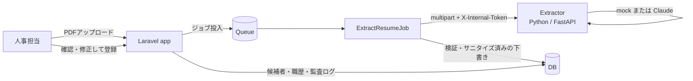
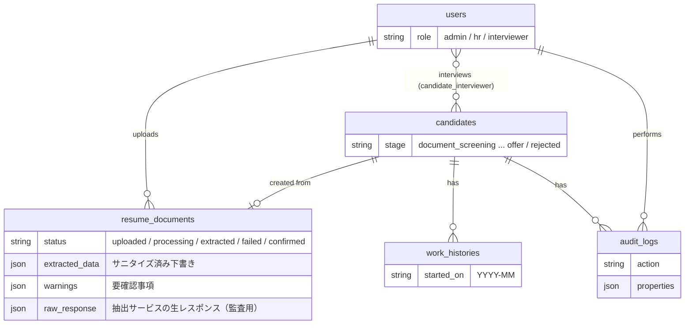

# Candidate Hub

履歴書PDFをアップロードすると、AIが氏名・連絡先・職歴などを抽出して入力フォームに**下書き**として反映し、人事担当者が確認・修正してから候補者として登録する採用管理アプリです。
登録後は選考ステージ（書類選考 → 一次面接 → 最終面接 → 内定／不採用）と面接官のアサインを管理できます。

[English below](#english)


## 主な機能

| 機能 | 内容 |
| --- | --- |
| 履歴書取込 | PDFアップロード → キューでAI抽出 → 原本と並べて確認・修正 → 候補者登録 |
| 選考管理 | ステージ遷移ルールを強制（飛び級・差し戻し・終了後の変更は不可） |
| 権限管理 | 管理者／人事担当／面接官。面接官はアサインされた候補者のみ閲覧可、履歴書原本は閲覧不可 |
| 監査ログ | ステージ変更・面接官アサイン・AI下書きからの修正項目を記録 |
| ユーザー管理 | 社内ツールのため自己登録なし。管理者がアカウントを発行 |

## アーキテクチャ



- **Laravel**：ドメインの中心。候補者・選考ステージ・権限・監査ログ・人による確認フローを担当。
- **Extractor（`./extractor`）**：PDF → 構造化JSONだけを行うステートレスなマイクロサービス。ファイルや結果は保存しない。
  - `EXTRACTOR_PROVIDER=mock`：ルールベース抽出（APIキー不要。デモ・テスト用、LLMの比較用ベースライン）
  - `EXTRACTOR_PROVIDER=claude`：Claudeのtool useでスキーマに沿ったJSONを出力
- Laravel側は `ResumeExtractor` インターフェースにのみ依存しているため、抽出エンジンの差し替えはドメインコードに影響しません。

## データモデル



## 設計上の判断

1. **AIの出力は「信頼できない入力」として扱う**
   AIの抽出結果は直接候補者テーブルに書き込まず、必ず人が確認してから登録します（`ConfirmResume` が唯一の登録経路）。
2. **検証を3層で行う**
   Claudeのtool use（スキーマ強制）→ Pydantic → Laravelの `ExtractionResult`。
   レスポンス全体の形式が壊れていれば失敗、**個別フィールド**（メール形式・年月など）が不正なら、そのフィールドだけ破棄して警告として画面に表示します。1項目の誤りで下書き全体を捨てないためです。
3. **リトライすべき失敗とすべきでない失敗を分ける**
   タイムアウト・5xxは一時的な障害としてキューでリトライ。スキーマ違反や読めないPDFは同じ入力で同じ結果になるため即失敗にし、無駄なリトライ（とLLMのコスト）を避けます。
4. **AIの精度を計測できるようにする**
   登録時に、人がAIの下書きから修正した項目（`corrected_fields`）を監査ログに残します。抽出エンジンを変えたときの精度比較に使えます。
5. **個人情報への配慮**
   履歴書はprivateディスクに保存し、権限チェック付きのルートからのみ配信。面接官は原本にアクセスできません。抽出サービスはファイルを保存せず、エラーログにも本文を出しません。サービス間通信は共有トークンで認証します。
6. **ステージ遷移はドメインで強制**
   `Stage` enum に許可される遷移を定義し、`Candidate::transitionTo()` が検証と監査ログ記録を同一トランザクションで行います。
7. **年月は `YYYY-MM` 文字列で保存**
   履歴書の職歴は月単位の精度しかないため、存在しない「日」を作らないようにしています。

## セットアップ

### Docker（推奨）

```bash
docker compose up --build
# http://localhost:8000
```

### ローカル

```bash
composer setup                 # composer install / .env / key:generate / migrate / npm build
php artisan db:seed            # デモデータ
php artisan serve              # http://localhost:8000
php artisan queue:work         # 別ターミナル：抽出ジョブ用ワーカー

cd extractor
python -m venv .venv && source .venv/bin/activate
pip install -r requirements-dev.txt
EXTRACTOR_TOKEN=local-dev-token uvicorn app.main:app --port 8001
```

Claudeで抽出する場合は、extractorを `EXTRACTOR_PROVIDER=claude ANTHROPIC_API_KEY=...` で起動してください。

### デモアカウント（パスワードはすべて `password`）

| メール | 権限 |
| --- | --- |
| admin@example.com | 管理者 |
| hr@example.com | 人事担当 |
| interviewer@example.com | 面接官（2名の候補者にアサイン済み） |

サンプル履歴書（架空の人物）：`extractor/tests/fixtures/sample_resume.pdf`

## テスト

```bash
php artisan test                      # Laravel（Feature / Unit）
cd extractor && pytest                # Extractor
```

- 抽出サービスは `Http::fake()` でHTTP層をフェイクし、実際の `HttpResumeExtractor` とサニタイズ処理をテストしています。
- `ExtractorContractTest` は実際のExtractorを起動してLaravel ↔ Python間の契約を検証します（CIでは自動実行、ローカルでは `EXTRACTOR_INTEGRATION_URL` を設定した場合のみ）。
- CI（GitHub Actions）：Laravelテスト（PHP 8.3 / 8.4）、Extractorテスト、Docker Composeのスモークテスト。

## 今後の改善案

- 画像のみのPDF（スキャン）向けOCR
- 抽出エンジンごとの精度ダッシュボード（`corrected_fields` の集計）
- 面接評価シートの入力と集計
- 本番向け構成（MySQL、Redisキュー、S3互換ストレージ、Horizon）

## AIの活用について

本リポジトリは、Laravelの習得を兼ねて2026年11月に作成しました（普段の業務はNode.js / Go が中心です）。
実装には Claude Code を活用しましたが、設計判断（データモデル、確認フロー、検証方針、権限設計）は自分で行い、コードはすべてレビュー・動作確認しています。

---

<a id="english"></a>

## English

**Candidate Hub** is a recruiting tool for HR teams. HR staff upload a resume PDF, an AI extraction microservice turns it into a structured **draft**, and a human reviews and corrects it side by side with the original before it becomes a candidate record. Candidates then move through an enforced selection pipeline (screening → 1st interview → final interview → offer / rejected) with interviewer assignment and an audit trail.

**Stack:** Laravel 13 (PHP 8.3+), Blade + Tailwind CSS, queued jobs, SQLite (dev) · Python 3.12 / FastAPI extractor (rule-based mock or Claude tool use) · PHPUnit, pytest · GitHub Actions · Docker Compose.

**Key design decisions**

- **LLM output is untrusted input.** Nothing extracted reaches the candidate tables without human confirmation; `ConfirmResume` is the only write path.
- **Three layers of validation** (forced tool schema → Pydantic → Laravel `ExtractionResult`). A broken envelope fails the job; a broken *field* is dropped and surfaced as a warning, so one bad value does not discard a useful draft.
- **Transient vs. permanent failures.** Timeouts/5xx are retried by the queue; contract violations fail fast to avoid pointless retries and LLM cost.
- **Measurable AI quality.** Fields the reviewer corrected are logged (`corrected_fields`), giving a cheap accuracy signal per extractor.
- **Personal data handling.** Private storage, policy-guarded file streaming, interviewers cannot see raw resumes, the extractor is stateless and never logs resume text, service-to-service token auth.
- **Domain-enforced stage transitions** via the `Stage` enum and `Candidate::transitionTo()` (validated + audited in one transaction).

**Run it:** `docker compose up --build` → http://localhost:8000 (demo accounts above, password `password`).

**AI usage:** Built in November 2026 while learning Laravel (my day-to-day stack is Node.js / Go), with Claude Code as a coding assistant. I made the design decisions and reviewed and tested the code myself.
