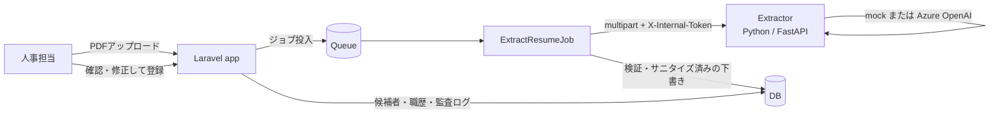
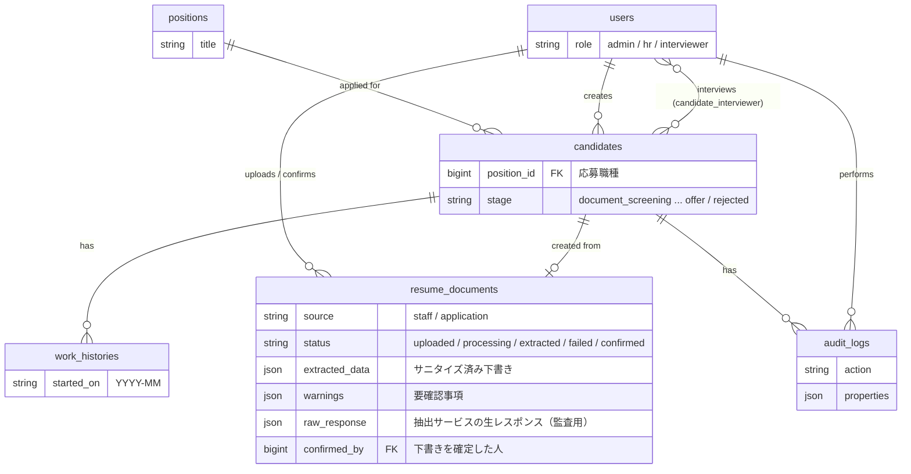

# Candidate Hub

半構造化された日本語の履歴書・職務経歴書（PDF）をLLMで解析し、入力フォームを自動入力するLaravelアプリです。
AIの出力は信頼できない入力として扱い、必ず人が原本と見比べて確認・修正してから登録します。
登録されたデータは、そのまま採用選考のワークフロー（選考ステージ・面接官アサイン・監査ログ）に引き継がれます。

[English](README-en.md)


## なぜこのテーマか

日本の履歴書・職務経歴書は、ある程度決まった書式がありながら、項目の並びや書き方は人によってばらばらです。人事担当者がそれを手で入力し直す作業は、採用の現場で実際に負担になっています。一方で、AIに完全自動で登録させるのは誤りが混入するリスクが高いため、「AIが下書きを作り、人が確認して確定する」形にしました。

## 主な機能

**履歴書の自動入力（中心機能）**

| 機能 | 内容 |
| --- | --- |
| AI抽出 | PDFアップロード → キューでジョブ実行 → 抽出サービス（ルールベース／Azure OpenAI）が構造化JSONを返す |
| 確認・修正画面 | 左に原本PDF、右に自動入力済みのフォーム。不正な項目は警告として表示し、人が修正してから確定 |
| 精度の記録 | 確定時に、人がAIの下書きから修正した項目（`corrected_fields`）を記録 |
| 採用ページ（公開） | ログイン不要の求人一覧・募集要項・応募フォーム（`/jobs`）。応募者が履歴書をアップロードするとフォームに自動入力され、**応募者本人が確認・修正してから送信**する。応募職種が付いた状態で書類選考に入る。個人情報の取り扱いへの同意必須、IPごとの回数制限あり |

**登録後の採用ワークフロー**

| 機能 | 内容 |
| --- | --- |
| 選考管理 | ステージ遷移ルールを強制（飛び級・途中の差し戻し・内定後の変更は不可。不採用からは確認ダイアログを経て書類選考に戻して再選考できる） |
| 権限管理 | 管理者／人事担当／面接官。面接官はアサインされた候補者のみ閲覧可、履歴書原本は閲覧不可 |
| 監査ログ | ステージ変更・面接官アサイン・AI下書きからの修正項目を記録 |
| ユーザー管理 | 社内ツールのため自己登録なし。管理者がアカウントを発行 |

## アーキテクチャ



- **Laravel**：ドメインの中心。候補者・選考ステージ・権限・監査ログ・人による確認フローを担当。
- **Extractor（`./extractor`）**：PDF → 構造化JSONだけを行うステートレスなマイクロサービス。ファイルや結果は保存しない。
  - `EXTRACTOR_PROVIDER=mock`：ルールベース抽出（APIキー不要。デモ・テスト用、LLMの比較用ベースライン）
  - `EXTRACTOR_PROVIDER=azure_openai`：Azure OpenAIのStructured Outputs（JSONスキーマ強制）でスキーマに沿ったJSONを出力
- Laravel側は `ResumeExtractor` インターフェースにのみ依存しているため、抽出エンジンの差し替えはドメインコードに影響しません。

## データモデル



- `resume_documents.source`：`staff` は人事が履歴書取込からアップロード（人事が確認）、`application` は応募者が採用ページからアップロード（応募者本人が確認）。
- 削除時の扱い：候補者を削除すると職歴・面接官アサイン・監査ログも削除し、履歴書は紐付けだけを外します。職種やユーザーを削除した場合は参照を `null` にし、候補者と監査ログは残します。
- 候補者のプロフィール項目（住所・学歴・希望条件など約25列）は図では省略しています。

## 設計上の判断

1. **AIの出力は「信頼できない入力」として扱う**
   AIの抽出結果は直接候補者テーブルに書き込まず、必ず人が確認してから登録します。人事は `ConfirmResume`、応募者は採用ページの応募フォーム（`SubmitApplication`）で自分の下書きを確認します。採用ページでは応募者は自分のアップロードにしかアクセスできません（IDはURLではなくセッションに保持）。
2. **検証を3層で行う**
   Azure OpenAIのStructured Outputs（スキーマ強制）→ Pydantic → Laravelの `ExtractionResult`。
   レスポンス全体の形式が壊れていれば失敗、**個別フィールド**（メール形式・年月など）が不正なら、そのフィールドだけ破棄して警告として画面に表示します。1項目の誤りで下書き全体を捨てないためです。
3. **リトライすべき失敗とすべきでない失敗を分ける**
   タイムアウト・5xxは一時的な障害としてキューでリトライ。スキーマ違反や読めないPDFは同じ入力で同じ結果になるため即失敗にし、無駄なリトライ（とLLMのコスト）を避けます。
4. **AIの精度を計測できるようにする**
   登録時に、人がAIの下書きから修正した項目（`corrected_fields`）を監査ログに残します。抽出エンジンを変えたときの精度比較に使えます。
5. **個人情報への配慮**
   履歴書はprivateディスクに保存し、権限チェック付きのルートからのみ配信。面接官は原本にアクセスできません。抽出サービスはファイルを保存せず、エラーログにも本文を出しません。サービス間通信は共有トークンで認証します。
   - 確定前の下書き（確認待ち・解析失敗）は削除でき、DBの行だけでなくファイルも消します。監査ログにはファイル名を残しません（氏名が含まれることが多いため）。
   - 性別は任意・自己申告のみ（未記入可）。履歴書の様式でも任意項目になっているためです。
   - 備考（人事メモ）と応募経路は社内専用で、採用ページの応募フォームからは設定できません。
6. **ステージ遷移はドメインで強制**
   `Stage` enum に許可される遷移を定義し、`Candidate::transitionTo()` が検証と監査ログ記録を同一トランザクションで行います。
7. **年月は `YYYY-MM` 文字列で保存**
   履歴書の職歴は月単位の精度しかないため、存在しない「日」を作らないようにしています。
8. **履歴書の解析はジョブキューで非同期に行う**
   AIによる抽出は10〜60秒かかるため、アップロードのリクエスト内では実行しません。アップロード時は保存と `ExtractResumeJob` の投入だけを行ってすぐに応答し、キューワーカーが抽出サービスを呼び出します。画面は `resumes/{id}/status` をポーリングし、完了すると自動で更新されます。
   - ブラウザのタイムアウトやWebプロセスの占有を防げ、抽出が遅い・落ちている場合でもアップロード自体は成功します。
   - 一時的な障害は `--tries=3 --backoff=10` で自動リトライし、最終的に失敗したものは「解析失敗」として人が再解析できます（上記3）。
   - 状態は `ResumeStatus` のステートマシン（解析待ち → 解析中 → 確認待ち／解析失敗）で管理し、重複実行されたジョブが確認済みの下書きを上書きしないようにしています。
   - キューはデモ用に `database` ドライバ（SQLiteの `jobs` テーブル）を使用。コードを変えずにRedisやSQSへ切り替えられます。
   - 注意：`queue:work` は起動時のコードをメモリに保持するため、デプロイ後は `php artisan queue:restart` が必要です（開発中は `queue:listen` を推奨）。
9. **PDFは文字の位置からテキストを再構成する**
   日本の履歴書・職務経歴書の多くは表や書式で、出力されたPDFでは印字されたラベル（氏名・性別・会社名など）と入力された値が別レイヤーになっていることがあります。ストリーム順に読むとラベルがすべて先、値がすべて後ろに並び、LLMがどの値がどのラベルのものか判断できません。そこで `extractor/app/pdf.py` ではpdfplumberで文字の座標から行を組み立て、値をラベルと同じ行（または直下）に、表の各行をセルの列順に保ちます。
   - `layout=True` は値の中の空白まで広げてしまう（架空 太郎 → 架空    太郎）ため使っていません。
   - NFKC正規化で、一部のフォントが出力する似た別の文字（⽣年⽉⽇ → 生年月日、全角数字など）を揃えます。

## セットアップ

### Docker（推奨）

```bash
docker compose up --build
# http://localhost:8000
```

### ローカル

```bash
composer setup                 # composer install / .env / key:generate / migrate / npm build
php artisan db:seed            # デモデータ
php artisan serve              # http://localhost:8000
php artisan queue:work         # 別ターミナル：抽出ジョブ用ワーカー

cd extractor
python -m venv .venv && source .venv/bin/activate
pip install -r requirements-dev.txt
EXTRACTOR_TOKEN=local-dev-token uvicorn app.main:app --port 8001
```

Azure OpenAI（Foundry）のデプロイ（例: gpt-6-luna）で抽出する場合：

```bash
EXTRACTOR_PROVIDER=azure_openai \
AZURE_OPENAI_ENDPOINT=https://<resource>.cognitiveservices.azure.com/ \
AZURE_OPENAI_API_KEY=... \
AZURE_OPENAI_DEPLOYMENT=gpt-6-luna \
uvicorn app.main:app --port 8001
```

エンドポイントはFoundryの**プロジェクト**ではなく**リソース**のURLを指定してください（プロジェクト経由ではgpt-6-lunaが500を返す既知の問題があります）。

### デモアカウント（パスワードはすべて `password`）

| メール | 権限 |
| --- | --- |
| admin@example.com | 管理者 |
| hr@example.com | 人事担当 |
| interviewer@example.com | 面接官（2名の候補者にアサイン済み） |

サンプル（架空の人物）：`extractor/tests/fixtures/sample_resume.pdf`（履歴書）、`extractor/tests/fixtures/career_sheet.pdf`（記入済みキャリアシート）

デモ中に追加・変更したデータは、ダッシュボードの「デモデータをリセット」ボタン（管理者・人事担当のみ）または `php artisan demo:reset` で初期状態に戻せます。`DEMO_MODE=true` のときだけ有効です。

## テスト

```bash
php artisan test                      # Laravel（Feature / Unit）
cd extractor && pytest                # Extractor
```

- 抽出サービスは `Http::fake()` でHTTP層をフェイクし、実際の `HttpResumeExtractor` とサニタイズ処理をテストしています。
- `ExtractorContractTest` は実際のExtractorを起動してLaravel ↔ Python間の契約を検証します（CIでは自動実行、ローカルでは `EXTRACTOR_INTEGRATION_URL` を設定した場合のみ）。
- CI（GitHub Actions）：Laravelテスト（PHP 8.3 / 8.4）、Extractorテスト、Docker Composeのスモークテスト、コンテナイメージのビルド。

## コンテナイメージ（ECR）

CIはPRごとに2つのイメージ（`app` / `extractor`）をビルドし、`master` へのマージ時にAmazon ECRへプッシュします（タグはコミットSHAと `latest`）。認証はGitHub OIDCで、アクセスキーは保存しません。

リポジトリ変数 `AWS_ROLE_ARN` が未設定の間はビルドのみ行います。プッシュを有効にするには：

1. ECRリポジトリ `mwx-candidate-hub-app` と `mwx-candidate-hub-extractor` を作成
2. IAMにGitHubのOIDCプロバイダ（`token.actions.githubusercontent.com`）を追加
3. IAMロールを作成：信頼ポリシーは `repo:<owner>/<repo>:ref:refs/heads/master` のみ許可、権限は `ecr:GetAuthorizationToken` と上記2リポジトリへのプッシュのみ
4. GitHubのリポジトリ変数に `AWS_ROLE_ARN`（ロールのARN）と `AWS_REGION`（例：`us-west-2`）を設定

## 今後の改善案

- 画像のみのPDF（スキャン）向けOCR
- 抽出エンジンごとの精度ダッシュボード（`corrected_fields` の集計）
- 面接評価シートの入力と集計
- 本番向け構成（MySQL、Redisキュー、S3互換ストレージ、Horizon）

## AIの活用について

Laravelの習得を兼ねて、2026年11月に3日間で作成しました（普段の業務はNode.js / Goが中心です）。
**コードの大部分は Claude Code が書いています。** 私の役割は、何をどう作るかを決めてAIに指示し、出てきたものを判断・検証することでした。

**自分で行ったこと**
- **設計判断**：データモデル、「AIが下書き・人が確定」という確認フロー、3層の検証方針、リトライすべき失敗とすべきでない失敗の区別、権限設計、個人情報の扱い（詳細は上記「設計上の判断」）
- **AIへの指示と取捨選択**：要件と制約を伝え、提案を採用・修正・却下する判断
- **検証**：各機能が設計どおりに動くことを実際に操作して確認。細部の実装はテスト（100件以上）とCI（Docker上のE2Eスモークテストを含む）で担保しています

**Claude Code に任せたこと**
- コードの実装、テストコードの作成、画面・設定などの定型作業

AIを使えば実装の速度は大きく上がりますが、「何を自動化し、どこで人が判断するか」「失敗したときにどうなるべきか」は人が決める必要があります。このリポジトリでは、その判断の部分を見ていただければ幸いです。
